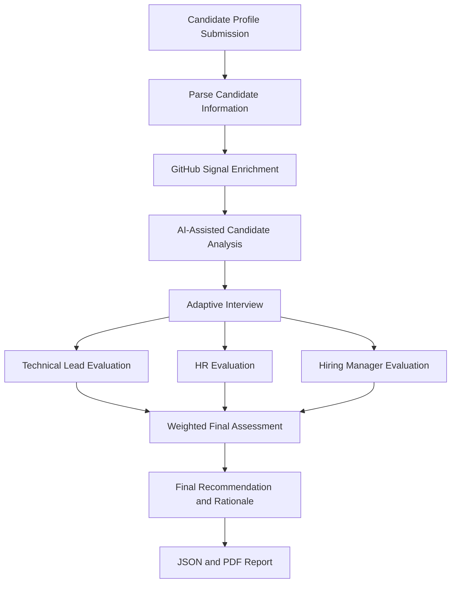

SmartHireX — Autonomous Hiring Intelligence Platform
Evaluate evidence, not just resumes.

SmartHireX is an AI-assisted hiring evaluation platform that looks beyond resume keywords. It combines candidate profile information, GitHub-derived signals, adaptive interview questions, and a simulated hiring panel to produce a structured, explainable evaluation report.

The goal is to help recruiters, hiring managers, and technical leads review candidate evidence more consistently—not to replace human judgment or make hiring decisions autonomously.
Contents
- Why SmartHireX?
- How It Works
- Key Features
- Architecture
- Tech Stack
- Getting Started
- Environment Variables
- API Reference
- Project Structure
- Configuration and Troubleshooting
- Responsible Use
- Roadmap
🎯 Why SmartHireX?
Traditional screening often depends heavily on resume wording and static interviews. These can make it difficult to understand how a candidate works, what they have built, and where their strengths or gaps lie.

SmartHireX explores a more evidence-oriented workflow:
- More than resume keywords: enriches candidate context with available GitHub profile and repository signals.
- Adaptive interviews: generates follow-up questions based on the candidate's context and answers.
- Multiple perspectives: simulates technical-lead, HR, and hiring-manager viewpoints.
- Explainable outputs: presents scores alongside reasoning and supporting context.
- Shareable reports: provides structured JSON and downloadable PDF reports.
🔄 How It Works

1. Submit a candidate profile with basic background, project details, and a GitHub URL.
2. Parse and enrich the submitted information using the GitHub integration where available.
3. Analyze the evidence to build a structured candidate summary and extract relevant signals.
4. Run an adaptive interview with a dynamic sequence of approximately 3–5 questions.
5. Generate panel perspectives from technical-lead, HR, and manager evaluation agents.
6. Review the result including the aggregate score, priority level, agent-wise assessments, and rationale.
7. Download the report in PDF or JSON format.
✨ Key Features
Candidate evidence enrichment
Uses GitHub profile and repository information as additional context when accessible. GitHub activity is only one possible signal and should not be treated as a complete measure of ability.
Adaptive interview intelligence
Creates questions based on candidate context and uses submitted answers to guide follow-up questions. The interview is bounded to a minimum of three and a maximum of five questions.
Multi-agent hiring simulation
Produces separate perspectives for:
- Technical Lead — technical depth and evidence of implementation.
- HR — communication and role-related professional signals.
- Hiring Manager — overall fit against the supplied evaluation context.
These are simulated AI perspectives, not actual human reviewers.
Explainable assessment
Returns per-agent scores and reasoning, a weighted aggregate score, a priority category, and a final recommendation rationale.
Downloadable reports
Creates a structured report payload and supports PDF report downloads and JSON output for downstream review.
🏗 Architecture
SmartHireX uses a React frontend and a FastAPI backend.
Browser (React + Vite)
        |
        | HTTP / JSON
        v
FastAPI application
        |
        +--> Hiring pipeline
        |      +--> Candidate parsing
        |      +--> GitHub enrichment
        |      +--> Candidate analysis
        |
        +--> Adaptive interview engine
        |
        +--> Multi-agent decision system
        |
        +--> Report builder (PDF + JSON)
        |
        +--> In-memory job state store
        |
        +--> LLM provider / GitHub API
The current job store is in-memory, so active job state is not durable across server restarts. For production use, replace it with persistent storage and add appropriate authentication, authorization, monitoring, and operational safeguards.
🧰 Tech Stack
Area	Technology
Backend language	Python 3.12
API framework	FastAPI
Data validation	Pydantic
ASGI server	Uvicorn
HTTP client	HTTPX
LLM integration	OpenAI-compatible client with configurable providers
GitHub enrichment	GitHub REST API
PDF generation	ReportLab
Frontend	React 18
Frontend tooling	Vite
HTTP requests	Axios
Python dependency management	uv
JavaScript dependency management	npm

See [`TECH_STACK.md`](TECH_STACK.md) for the project's stack notes and [`PRD.md`](PRD.md) for product requirements.
🚀 Getting Started
Prerequisites
Install the following before running the project:
- Python 3.12
- uv
- Node.js and npm
- An API key for a supported LLM provider
- Optional: a GitHub personal access token for higher GitHub API rate limits
1. Clone the repository
git clone <your-repository-url>
cd SmartHireX
Replace <your-repository-url> with your repository's clone URL.
2. Configure environment variables
Create a .env file in the project root. See Environment Variables below.
3. Install backend dependencies
uv sync
4. Start the backend
From the project root:
uv run uvicorn main:app --reload --host 127.0.0.1 --port 8010
The API will be available at http://127.0.0.1:8010.

FastAPI's interactive API documentation is available at http://127.0.0.1:8010/docs.
5. Install and start the frontend
Open a second terminal:
cd frontend
npm install
npm run dev
Vite prints the local frontend URL in the terminal (usually http://localhost:5173). Open that address in your browser.
6. Optional: build the frontend
To create a production frontend bundle:
cd frontend
npm run build
The build output is written to frontend/dist. The backend is configured to serve the built frontend when the expected build files are present.
🔐 Environment Variables
Set only the provider variables you need. Never commit API keys or real secrets to source control.
Variable	Required?	Purpose
LLM_PROVIDER	Optional	Selects featherless, groq, or openai; provider selection may otherwise use the default logic.
FEATHERLESS_API_KEY	Optional	API key for Featherless AI; preferred by default when present.
FEATHERLESS_BASE_URL	Optional	Featherless API base URL; defaults to https://api.featherless.ai/v1.
FEATHERLESS_MODEL	Optional	Featherless model identifier; defaults to moonshotai/Kimi-K2-Instruct.
GROQ_API_KEY	Optional	API key for Groq when using that provider.
OPENAI_API_KEY	Provider-dependent	API key for OpenAI when using that provider.
OPENAI_MODEL	Optional	OpenAI model name; defaults to gpt-4.1-mini in the project configuration.
GITHUB_TOKEN	Optional	GitHub token to increase API rate limits for enrichment requests.

Example .env:
# Choose one supported provider
LLM_PROVIDER=featherless
FEATHERLESS_API_KEY=your_featherless_api_key
FEATHERLESS_BASE_URL=https://api.featherless.ai/v1
FEATHERLESS_MODEL=moonshotai/Kimi-K2-Instruct

# Optional GitHub API token
GITHUB_TOKEN=your_github_token
If you use Groq or OpenAI instead, configure the corresponding provider and API key according to the provider implementation in backend/services/llm_service.py.
🔌 API Reference
Base URL for local development: http://127.0.0.1:8010
Method	Endpoint	Description
GET	/	Serves the frontend entry point.
GET	/api/health	Health-check endpoint.
POST	/api/pipeline/jobs	Creates a candidate-evaluation job and starts the pipeline.
GET	/api/pipeline/jobs/{job_id}	Retrieves job status, pipeline steps, interview state, and available results.
POST	/api/pipeline/jobs/{job_id}/interview	Submits an interview answer and advances the interview.
GET	/api/report/{job_id}	Downloads the final PDF report.
GET	/api/report/{job_id}/json	Returns the final report as JSON.

Use http://127.0.0.1:8010/docs for interactive API documentation and request schemas.
Evaluation result
The final result may include:
- candidate_summary
- extracted_signals
- interview transcript and summary
- agent_decisions with agent-level scores and reasoning
- final_score
- priority_level
- reasoning explaining the final assessment
Exact fields depend on the response schema and the state of the evaluation job.
📁 Project Structure
SmartHireX/
├── backend/
│   ├── pipeline/
│   │   ├── parser.py             # Candidate input parsing
│   │   ├── enrichment.py         # External signal enrichment
│   │   ├── analyzer.py           # Candidate evidence analysis
│   │   ├── interview.py          # Adaptive interview flow
│   │   ├── multi_decision.py     # Multi-agent evaluation
│   │   └── hiring_pipeline.py    # Pipeline orchestration
│   ├── reporting/
│   │   └── report_builder.py     # Report payload and PDF generation
│   ├── services/
│   │   ├── github_service.py     # GitHub API integration
│   │   └── llm_service.py       # LLM provider integration
│   ├── job_store.py              # In-memory job state
│   └── schemas.py                # Request and response schemas
├── frontend/                     # React + Vite application
├── data/                         # Demo candidates and evaluation data
├── tests/                        # Automated tests, if present
├── main.py                       # FastAPI app and API routes
├── pyproject.toml                # Python dependencies and project config
├── uv.lock                       # Locked Python dependencies
├── package-lock.json             # Root npm lockfile, if used
├── TECH_STACK.md                 # Technology overview
├── PRD.md                        # Product requirements
├── APP_FLOW.md                   # User flow notes
├── BACKEND_STRUCTURE.md          # Backend design notes
├── FRONTEND_GUIDELINES.md        # Frontend guidelines
└── IMPLEMENTATION_PLAN.md         # Implementation plan
🧪 Testing
The project configures pytest to discover tests in the tests/ directory. If tests are present, run:
uv run pytest
To verify the backend starts, run the Uvicorn command in the Getting Started section. To inspect available API routes and schemas, open /docs.
🛠 Configuration and Troubleshooting
LLM authentication or provider errors
- Check that the selected provider's API key is set in the root .env file.
- Confirm LLM_PROVIDER matches a provider supported by backend/services/llm_service.py.
- Check provider quota, model availability, and rate limits.
GitHub enrichment fails or is rate-limited
- Set GITHUB_TOKEN to a valid token.
- Check that the GitHub profile URL is valid and publicly accessible.
- Treat unavailable GitHub information as missing evidence, not proof of low ability.
Frontend cannot reach the backend
- Confirm the backend is running on port 8010.
- Check the frontend's API base URL configuration and browser developer console.
- Confirm that local development and production API URLs are configured appropriately.
PDF report is unavailable
- Confirm the job has completed its interview and final assessment.
- Check the backend logs for report-generation errors.
- Ensure the process has write access to the report output directory.
⚖️ Responsible Use
SmartHireX is a decision-support prototype. AI-generated assessments can be incorrect, incomplete, inconsistent, or biased.
- Keep a human in the loop. Do not use a generated score as the sole basis for hiring, rejection, or other consequential decisions.
- Evaluate job-related evidence. Define role-relevant criteria and review the evidence behind each assessment.
- Do not overvalue GitHub. Public coding activity is not representative of every candidate's skills, especially for people whose work is private, academic, non-code-based, or outside GitHub.
- Protect candidate data. Obtain appropriate permission, minimize collected information, and define retention and deletion practices.
- Review AI output. Verify generated interview questions, summaries, scores, and rationales before acting on them.
- Audit for fairness. Test outcomes across relevant groups and provide a way for humans to challenge or correct inaccurate information.
The current project documents identity/authentication hardening and production-scale historical ranking as out of scope. Do not expose this prototype publicly with real candidate data until suitable privacy, security, reliability, and fairness controls are in place.
🗺 Roadmap
Potential next steps include:
- Persistent job and report storage
- Authentication, authorization, and tenant isolation
- More robust model-provider fallback and retry handling
- Role-specific evaluation rubrics and configurable score weights
- Evidence citations that link conclusions to source material
- Interview-quality and score-breakdown visualizations
- Historical comparisons across roles and candidate cohorts
- Automated tests for pipeline stages, API endpoints, and edge cases
- Observability for latency, failures, model usage, and cost
📚 Additional Documentation
- [`PRD.md`](PRD.md) — problem statement, users, requirements, and acceptance criteria
- [`APP_FLOW.md`](APP_FLOW.md) — application journey and flow
- [`TECH_STACK.md`](TECH_STACK.md) — technology choices
- [`BACKEND_STRUCTURE.md`](BACKEND_STRUCTURE.md) — backend structure
- [`FRONTEND_GUIDELINES.md`](FRONTEND_GUIDELINES.md) — frontend guidance
- [`ARCHITECTURE_AUDIT.md`](ARCHITECTURE_AUDIT.md) — architecture audit notes
- [`IMPLEMENTATION_PLAN.md`](IMPLEMENTATION_PLAN.md) — implementation plan and future scaling notes
